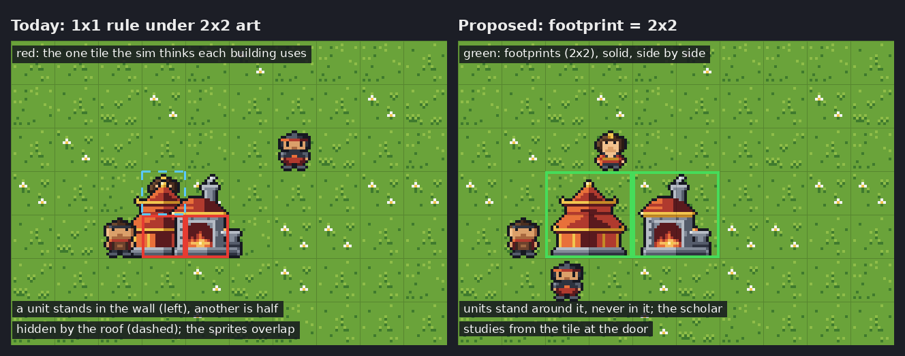
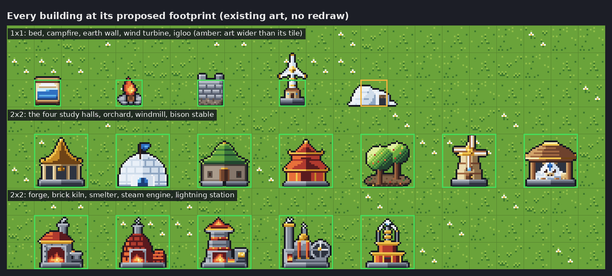
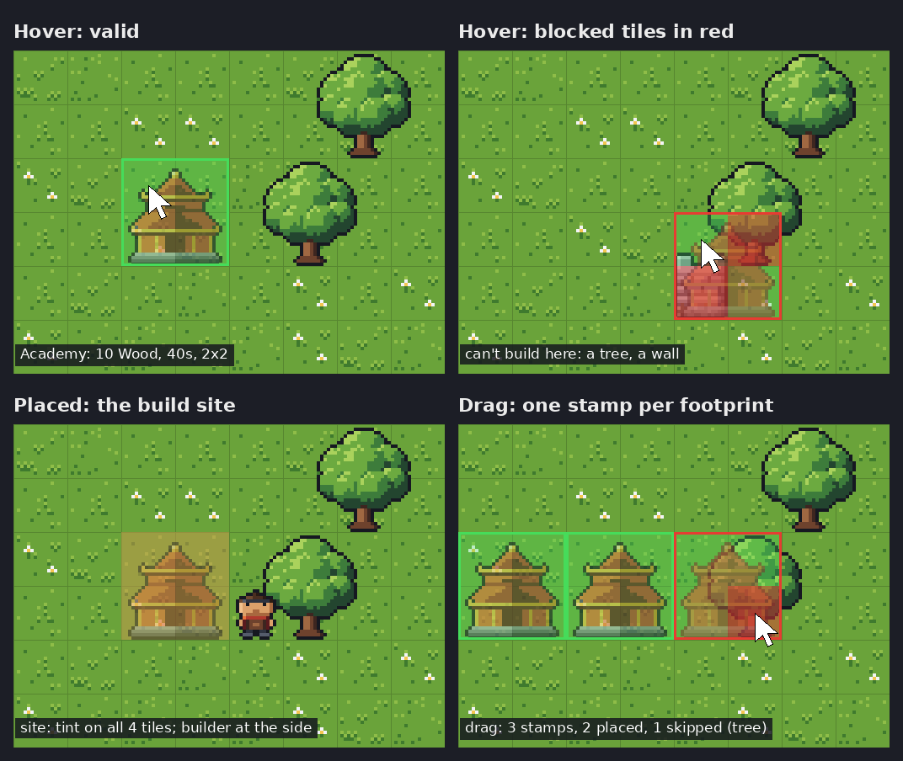

# Buildings: multi-tile footprints

Status: **proposed** (#196). Follow-up work is listed at the end of this doc. The owner questions
are at the end too, and the size table depends on them.

Every building is 1x1 in the rules today. `BuildingDef` has no size, the sim stores one
`Building` per tile (`World::building_at`), and `passable` covers that one tile. The art is
32x32, two tiles by two (#149, #175 to #178), drawn bottom-centred on that one tile like a tree.
So a study hall or a forge looks 2x2 but uses only 1x1:

- units walk through the visible body of a building (or stand in its wall);
- two buildings on neighbouring tiles overlap;
- the build-site tint marks one tile under a 2x2 sprite.



The bottom-left of this real headless shot (`FN_BUILD_DEMO=buildings`, Fire) shows a hall's build
site with its one-tile tint under the 2x2 ghost sprite:
[mockups/196/before-demo-fire.png](../../mockups/196/before-demo-fire.png).

## Decisions in brief

1. **A footprint is a rectangle in data.** `footprint = [w, h]` on a building in
   `data/buildings.toml`, default `[1, 1]`. Each side is 1 to 4 tiles. There are no masks or
   L-shapes, because all the art is rectangular.
2. **The anchor is the top-left tile.** `Command::DesignateBuild { pos }` names the anchor, and
   the footprint covers `pos.x .. pos.x + w` and `pos.y .. pos.y + h`. The frontends turn the
   cursor tile into the anchor, so the sim never needs to know where the pointer was.
3. **No rotation.** Every sprite faces the camera with its door at the bottom, so a rotated
   footprint would have no art to draw. Footprints are rectangles, so a 2x1 can be "rotated" by
   defining a 1x2 building if one is ever needed. (Owner question 3.)
4. **Every footprint tile carries the building.** The `Building` already baked onto
   `Tile::building` gains `part` (its offset from the anchor) and `size`. `building_at`,
   `passable`, pathfinding, regions and the bending checks keep working tile by tile and need no
   changes. The size is baked too, so a building keeps the size it was built with even if the
   data changes later. That is what makes old saves safe.
5. **Use from the edge.** A solid building is used (built, studied in) from any tile of the ring
   around its footprint. A walkable one is used from inside its footprint. There is no door tile.
6. **2x2 for everything drawn 2x2.** The existing 32x32 art already *is* a 2x2 footprint
   (16 px tiles). Sprites whose opaque base is about 28 px wide become 2x2, and the 16 px ones
   stay 1x1. No art is redrawn, except possibly the igloo (owner question 4).
7. **Saves need no version bump.** The new fields use `serde(default)` and are skipped when they
   are 1x1, so a v1 save loads with every building as the 1x1 it was built as, and a world of
   1x1 buildings writes the same text as before.

## Footprint sizes

The table follows the art: the width of each sprite's opaque base, measured from the
`assets/original/` PNGs. Then role and cost decide the cases the art leaves open.

| Building | Art base (px) | Footprint | Walkable | Why |
|---|---|---|---|---|
| bed | 16 | 1x1 | yes | One sleeper per bed, lies on its tile |
| campfire | 10 | 1x1 | yes | Cheap, placed often, near beds |
| earth_wall | 16 | 1x1 | no | Built in runs. The art fills its tile edge to edge (#175) |
| wind_turbine | 16 (blades 18) | 1x1 | no | A mast. The blades may overhang upward like a tree canopy |
| igloo | 30 x 13 | 1x1 | yes | A bed. The art is wider than its tile (owner question 4) |
| study hall (all four) | 26 to 30 | **2x2** | **no** (was yes) | The art's footprint. Scholars study from the door side |
| orchard | 24 to 28 | **2x2** | yes | A planted plot. People walk among the trees and later tend them (#142) |
| windmill | 22 | **2x2** | no | The sails need the width, and 1x1 would overlap its neighbours |
| bison_stable | 30 | **2x2** | no | 3x3 would suit a sky bison, but it needs new art (owner question 4) |
| forge, brick_kiln, smelter, steam_engine | 26 to 28 | **2x2** | no | The art's footprint |
| lightning_station | 26 | **2x2** | no | Same plinth as the others |



Costs and work times don't change. A 2x2 hall at 10 wood is cheap for its area, but balance is
out of scope here (#124 and #142 give these buildings a purpose and will retune them).

**Halls become solid.** Today the study hall is `passable = true` so that scholars can stand on
its tile. With a 2x2 body, walking through it is exactly the bug this design fixes, so halls
become `passable = false` and their scholars stand on the ring (see below). The pavilion is
open-sided, but it is still a raised platform. (Owner question 2.)

## Sim rules

### Data and types

```toml
[[building]]
id = "forge"
footprint = [2, 2]   # [width, height] in tiles; default [1, 1]
```

- `BuildingDef::footprint: (u8, u8)`. Load fails if a side is 0 or more than 4, or if a building
  with a `[building.bed]` isn't 1x1 (one sleeper per bed, lying on its tile). Bigger beds, such
  as a bunkhouse, would be a new design.
- `geom::Footprint { anchor: Pos, w: u8, h: u8 }` holds the geometry that everything shares:
  `tiles()` (row-major), `contains(p)`, `ring()` (the tiles around it, row-major, corners
  included, matching `NEIGHBORS` today) and `distance(p)` (Chebyshev distance to the rectangle,
  0 inside).
- `Building { id, passable, part: [u8; 2], size: [u8; 2] }`. Each footprint tile gets a copy
  with its own `part`, and the anchor is the tile whose `part` is `[0, 0]`.
- `Site` (keyed by anchor in `World::sites`) gains `size`. There are few sites at any time (tens),
  so the site covering a tile is found by scanning them, with no second index to keep in sync.
- Queries: `World::footprint_at(pos)` returns the finished building's or the site's footprint
  covering `pos`. `World::buildings()` yields each finished building once, as
  `(Footprint, BuildingId)` in anchor order, for the frontends. `build_sites()` yields a
  `Footprint` instead of a `Pos`.

### Placement

`World::check_build(anchor, building, defs) -> Result<(), BuildError>` is a pure function that
`designate_build` uses and the frontends call for the preview. It checks the tech first (as
today), then every footprint tile with `World::build_blocker(pos) -> Option<Blocker>`:

- **OffMap**: any tile is outside the map.
- **Terrain**: the tile isn't `Land` or `Coast`. That rules out water, mountains and **fords**.
  Mapgen places fords to keep landmasses connected (#30), so a solid building must never close
  one. A walkable bed on a ford is harmless, but one rule for every building is easier to
  explain. This is a small change for 1x1 buildings too.
- **Resource**: a tree, rock, bush and so on.
- **Building** or **Site**: no overlap with anything finished or designated.
- **Stockpile**: a stockpile zone tile. Today nothing stops a wall from going up on a stockpile
  tile and burying what's stored there.

A unit standing in the footprint does not block placement. `BuildError::CannotBuild` gains the
first blocked tile and the reason (`CannotBuild { at, why }`), so the UI can say "a tree is in
the way". `Command::DesignateBuild` is all-or-nothing: either the whole footprint is designated,
or nothing changes.

### Movement and where units stand

- **Blocking.** Every tile of a solid footprint blocks movement through `MoveRules::tile_cost`,
  which already reads the baked `passable`. A walkable footprint blocks nothing.
- **No door or entry tile.** A unit uses a building from the nearest tile it can reach (by flood
  cost, ties by `Pos`, as `World::stand` breaks them today). For a walkable building that is a
  footprint tile. For a solid one it is a ring tile, and this applies to the *site* too, so a
  builder never stands inside something that is about to become solid. A door would cost a data
  field, a per-building validity rule ("the door tile must stay free") and a failure mode (a
  blocked door) for very little gain at 2x2. The art's door is cosmetic. If production buildings
  (#124) later need a work spot, it can be added as data then.
- **Completion clears the footprint.** When a solid building finishes, each unit on its footprint
  moves to the nearest walkable tile outside it (Chebyshev rings, row-major, as `place_ground`
  searches) and drops its route, and ground stacks there move the same way through
  `place_ground`. Then `map_changed()` runs once. This also fixes a latent 1x1 bug: today the
  builder of an earth wall finishes it while standing on it.
- **Reachability isn't checked at placement.** As today, a site nobody can reach is abandoned
  by its builder and stays designated until it is cancelled.

### Sleeping, heat and study

- **Beds** stay 1x1 (enforced at load), so `bed_route` and `sleep_rate` don't change.
- **Heat.** `HeatSource` gains `size` (`serde(default)`, skipped when 1x1). `warms(p)` becomes
  `footprint.distance(p) <= radius`, so a 2x2 heat building warms `radius` tiles out from every
  side. `warm_sleep_route` scans the footprint grown by the radius. No building with `heat` is
  bigger than 1x1 today. This only keeps a future warm forge (#124) correct.
- **Study.** `JobKind::Study { pos }` names the anchor. `run_study` walks to the footprint's
  stand tile (the ring, now that halls are solid). Two scholars may share a ring tile, just as
  they share the hall's tile today.

### Cancel and deconstruct

- `Command::CancelBuild { pos }` accepts any tile of a site's footprint and cancels the whole
  site. Delivered materials drop near the anchor, as today.
- There is no deconstruct command yet. When one is added, a footprint is atomic: any tile names
  the building, the whole footprint clears in one tick, and the building's study seats and heat
  source (both keyed by the anchor) go with it.

### Saves and determinism

- **No `SAVE_VERSION` bump.** `part`, `size` (on `Building`, `Site` and `HeatSource`) are
  `#[serde(default, skip_serializing_if = ...)]` with 1x1 defaults. A v1 save reads as before,
  and every building and site in it is the 1x1 it was built as, even where the data now says
  2x2. They are "grandfathered" and stay drawn and used as 1x1 until they are deconstructed. The
  sim never re-derives a placed building's size from the data (decision 4).
- `Defs::id_hash` is unaffected: a footprint is a number, not an id.
- A **v1 fixture** (a small saved world with a bed, a hall and a site, checked in before the
  format changes) gets a test showing it still loads and plays after the change.
- **Determinism.** No RNG is involved. Footprint tiles, rings and searches are walked row-major,
  and every choice breaks ties on `(cost, Pos)` as today. The golden snapshots are mapgen-only,
  so they don't change. Replaying a command log recorded before footprints, against footprint
  data, gives a different game, but replay already requires identical data (save.rs).

## Client and UI



### Placing (shared in `fn_ui`)

- **Cursor to anchor.** `fn_ui::build::anchor_for(cursor, footprint)` returns
  `cursor - ((w - 1) / 2, (h - 1) / 2)`. Odd sizes centre on the cursor, and even sizes put the
  cursor in the top-left of the middle. For a 2x2 the ghost grows down and to the right from the
  pointer, so the pointer doesn't hide it.
- **Ghost.** While the Build tool is active, the hovered placement shows the building's sprite
  at 60% opacity. Each footprint tile is tinted green if `build_blocker` is `None` and red if
  not, and a red-tinted ghost means the click will be refused. The status line gives the first
  reason ("can't build here: a tree"). `fn_ui` exposes a
  `placement(session, cursor) -> Placement { footprint, tiles: Vec<(Pos, Option<Blocker>)> }`
  that both frontends draw.
- **Drag.** A Build drag stamps footprints on a lattice from the drag's start, stepping by
  `(w, h)`. Every stamp that fits inside the dragged rectangle is tried on its own, so a drag
  along a row lays halls side by side and skips the blocked ones ("2 done, 1 skipped (a
  tree)"). 1x1 drags (earth walls) behave as today.
- **Picker.** Each row shows the size after the cost ("10 Wood, 2x2"), but only for buildings
  bigger than 1x1.

### Drawing (`crates/client/src/buildings.rs`)

- **One sprite per building**, from `World::buildings()` and `build_sites()`, not one per tile.
- **Anchor.** The sprite's bottom-centre sits at the bottom-middle of the footprint: halfway
  across its `w` tiles, on the bottom edge of row `anchor.y + h - 1`. For a 1x1 that is today's
  position exactly.
- **Size.** A footprint of `w` tiles takes a sprite `w * 16` px wide. Height may exceed `h * 16`
  only to overhang *upward* (masts, sails, roofs), as trees do. 2x2 is the existing 32x32 cell
  (`big`). A 3x3 would be a 48x48 cell, which `Cell { w, h }` already supports. A client test
  checks each building's opaque width against its footprint (allowing 2 px), the same way
  `NO_ART_YET` is checked today.
- **`row_depth`.** `row_depth(anchor.y + h - 1)`, the footprint's front row. Units can't stand
  inside a solid footprint, so they are always fully in front or fully behind. A unit in the
  front row of a walkable footprint (the orchard) draws over it, and one further back draws
  behind it.
- **Fade (#77).** Building sprites join the canopy fade (`canopy.rs`'s `target_alpha`), but only
  where the sprite extends beyond its footprint or the footprint is walkable: the orchard, the
  turbine's blades, and grandfathered 1x1 halls. A 2x2 solid building that fills its footprint
  hides nothing, so it never fades.
- **Site overlay.** `designate.rs` tints every tile of a site's footprint, not just the anchor
  (see "Placed: the build site" in the mockup).
- **Hover and selection.** Hovering any footprint tile outlines the whole footprint, and the
  tooltip (`fn_ui::build::site_report`, `built_name`) is the same from every tile.
  `Command::CancelBuild` accepts any tile, so the Cancel tool works anywhere on the site.
- **Demo.** `FN_BUILD_DEMO=buildings` places through footprints, with each building's grid cell
  sized to its footprint plus a one-tile gap.

### TUI (`crates/tui`)

- Every footprint tile draws the building's glyph in its colours, so a forge reads as a 2x2 block
  of `Ω`. This needs no new data, a block is easy to read on a glyph map, and it matches the
  sprite. Box-drawing borders were considered, but they lose the building's identity on its
  inner tiles.
- A site is the same block, dimmed, as it is per tile today.
- The Build tool's cursor shows the footprint as the ghost block, green or red per tile (the
  same `fn_ui::placement`), and a drag stamps the same lattice.
- `--ascii` is the same with the `ascii` character.

## Migration

- **Behaviour.** Every building with no `footprint` is 1x1, and every 1x1 rule is today's rule,
  apart from the fords and stockpile placement rules, which are deliberate. The sim and frontend
  work can land with all data still 1x1, so nothing visible changes until the last issue turns
  the sizes on in `data/buildings.toml`.
- **Saves.** Old saves load as they are (above). Their halls stay 1x1, passable and overhanging
  until a future deconstruct command lets the player rebuild them. This is a personal project
  with few saves, so no automatic upgrade is worth its complexity.
- **Docs.** When the sizes turn on, the "Buildings" section of `pixel-art.md` changes from "stands
  on its tile like a tree" to "fills its footprint, and may overhang upward".

## Follow-up issues

Each is sized for one PR. Blocked-by links are recorded on the issues.

| # | Issue | Blocked by |
|---|---|---|
| #206 | Save: a checked-in v1 save fixture and a load test | none |
| #207 | Sim: building footprints in data, on tiles and in placement | #206 |
| #208 | Sim: using a multi-tile building (ring stand, clearing on completion, heat and study) | #207 |
| #209 | UI: shared footprint placement (cursor anchor, drag lattice, per-tile validity, any-tile cancel) | #207 |
| #210 | Client: draw buildings and sites by footprint | #207 |
| #211 | Client: placement ghost preview | #209, #210 |
| #212 | TUI: footprints as glyph blocks and the placement ghost | #209 |
| #213 | Art: the igloo fits its tile | none (owner question 4) |
| #214 | Data: turn on the footprint sizes and make halls solid | #208, #210, #211, #212 |

## Open questions for the owner

1. **Which buildings grow?** I recommend the table above: the four study halls, the orchard,
   windmill and bison stable, and all five Fire buildings become 2x2. The bed, campfire, earth
   wall, wind turbine and igloo stay 1x1.
2. **Do study halls become solid?** I recommend yes. Scholars study from the tiles around the
   hall, and nobody walks through it. The alternative is a walkable hall (scholars stand inside)
   that still blocks other buildings. That fits the open Meditation Pavilion, but units would
   draw over its pillars.
3. **Is rotation needed?** I recommend no. All the art faces the camera with its door at the
   bottom. Rotation would need four views of every sprite for a small gain in layout.
4. **Should any art be redrawn?** I recommend no redraw for 2x2, since the 32x32 art already
   fills it, plus one small redraw: the igloo, which is 30 px wide on a 16 px tile, narrowed to
   about 18 px so that igloos can stand side by side (#213). Leave 3x3 (a bigger bison stable or
   lightning station with new 48x48 art) for later. The schema and the client already allow it.
