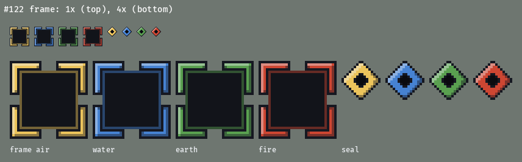
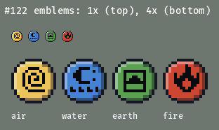
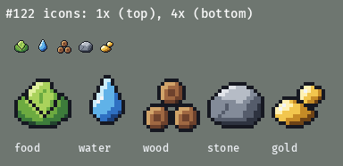
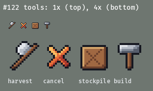
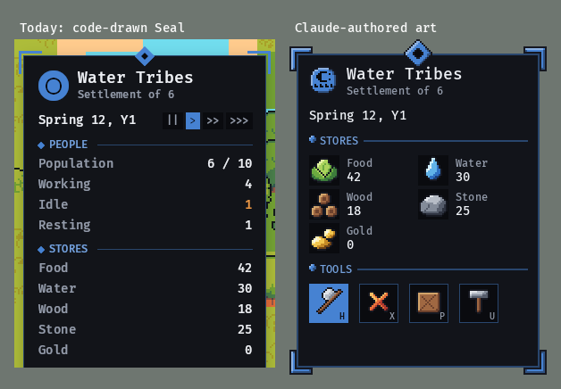
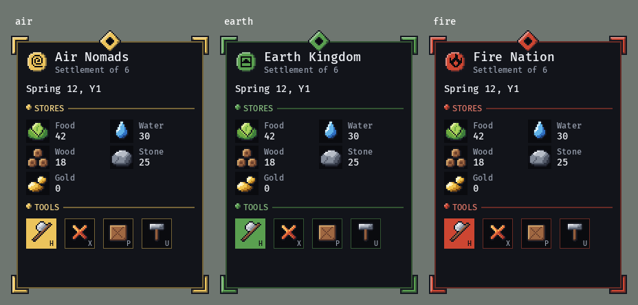
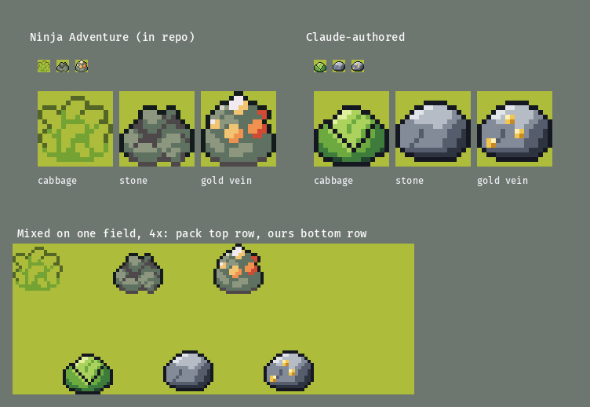
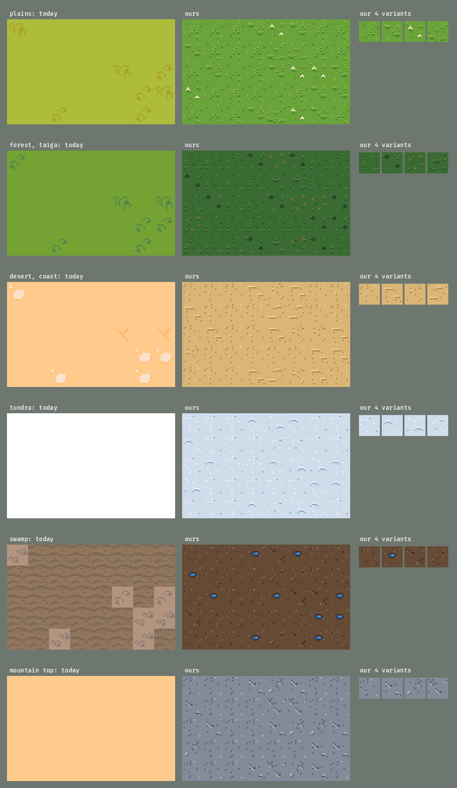

# Claude-authored pixel art

Status: **decided** (#122, owner, 2026-10-24): replace everything, in the style of the samples
below. The owner's answers are under "Owner decisions". Follow-ups: #128 to #131 and #144 to #155
(see "Scope and order").

The owner wants Claude to make all of the game's pixel art, replacing the third-party packs: Ninja Adventure (`docs/design/art.md`) and the code-drawn Seal flair
(`docs/design/ui.md`). Original art makes the look our own, fills the holes the pack audit found
(no cabbage, no inner cliff corners, a thin Air Nomad cast), and lets an agent draw art for a new
feature instead of hunting for a pack that has it.

Claude can't paint, but it can write text. So art is **authored as palette-indexed character
grids**, and a repo tool renders them to PNG. Every sample below was made that way.

## Decisions in brief

1. **Source is text.** One TOML file per sprite sheet under `art/`, one character per pixel,
   every character a name from one shared palette (`art/palette.toml`).
2. **Our own renderer.** `cargo xtask art` turns `art/*.toml` into `assets/original/*.png` and
   their manifest entries. `cargo xtask assets`, already part of `cargo xtask ci`, re-renders in
   memory and fails if a PNG is stale or holds an off-palette colour. No new tools and no Python.
3. **Pack conventions, our palette.** 16px cells, a 1px near-black outline, 3 to 5 tone ramps lit
   from the top left, no anti-aliasing. That's what Ninja Adventure does, so the two can share
   the screen while families are replaced one PR at a time.
4. **Nations through data.** Accent pixels are a 3-tone ramp mixed from the nation's `color` in
   `data/nations.toml`. UI tokens (`panel`, `inset`, `accent_soft`) come from `fn_ui::theme`, so a
   pixel frame matches the code-drawn widgets exactly.
5. **Everything gets replaced, one family per PR.** UI, icons, floors, water, cliffs, trees,
   resources, buildings, units, portraits and effects. A shared refactor (#144) goes first, so
   the families touch different client files and can run in parallel. Ninja Adventure leaves the
   manifest file by file, and the last of it goes in #155.
6. **Land tiles have texture.** Every floor has 4 variants with tufts, speckle, ripples or
   cracks, and the client picks one per tile with a stable hash (see "Land tiles").

## Samples

Each sample shows 1x on top and 4x below. Sources: `mockups/122/src/*.toml`, rendered by
`mockups/122/render.py` (the Python prototype of #128) and laid out by `mockups/122/mock.py`.






**Side by side with what ships today.** Left is a crop of the #39 reference render (the
code-drawn Seal panel over Ninja Adventure). Right is the same panel built from the samples at 2x,
with a two-column Stores grid and a tool row:




**Map sprites next to the pack**, on the pack's grass, using the in-repo Ninja Adventure cells the
client ships (`sprites::RESOURCES`): the cabbage stand-in (8,11), stone (6,14) and gold vein
(4,14):



What the comparison shows: at UI scale the hand-authored art holds up well. The emblems and
icons read at 2x, and the frame looks like a sprite rather than a box. On the map, the
cabbage is a clear improvement on the stand-in. Our rocks are smoother and cleaner than the
pack's mottled ones, so they'd stand out next to pack boulders. That's why each issue replaces a
whole family (all resources, all trees) at once, rather than one sprite at a time.

## Authoring format

```toml
# art/icons.toml -> assets/original/icons.png
cell = [16, 16]          # every sprite in the sheet is one cell; the sheet packs them in order
columns = 8              # optional; default is one row
outline = true           # optional: 1px `ink` outline around every filled pixel (4-neighbour)
per_nation = false       # true: one PNG per nation, `icons.<nation>.png`, accent keys resolved per nation

[legend]                 # optional: adds to palette.toml's [legend]
g = "gold2"

[[sprite]]
name = "stone"
legend = { "1" = "stone0", "2" = "stone1", "3" = "stone2", "4" = "stone3", "5" = "stone4" }
grid = """
................
......55444.....
....554444443...
...
"""
```

- **Palette** (`art/palette.toml`): about 32 named colours in ramps (`stone0`-`stone4`, `wood0`-`wood3`,
  `leaf0`-`leaf4`, `gold`, `water`, `red`, `cream`), plus `ink` (the outline) and `white`. An
  `[accent]` table defines `accent_dark` and `accent_light` as mixes of the nation colour toward
  `ink` and `white`. A shared `[legend]` gives every sheet the same keys for the UI: `.` clear,
  `o` ink, `i` inset, `p` panel, `s` accent_soft, `D`/`a`/`L` the accent ramp.
- **Digits are ramps.** A sprite binds `1`-`5` to one ramp, darkest first. Grids stay readable
  ("light top-left, dark bottom-right" is visible in the text), and recolouring a sprite is a
  one-line legend change.
- **Outlines are explicit or automatic.** Map sprites and icons draw fills only and set
  `outline = true`. The frame and medallions draw their outlines by hand because the outline is
  part of the shape.
- **A sprite can pin a nation** (`nation = "fire"`): the emblems sheet renders each emblem in its
  own nation's ramp.
- **Sheets, not loose files.** One PNG per sheet keeps the manifest short. The client names cells
  by `(column, row)` constants in the family's module (`sprites/floors.rs` and so on, after #144),
  as it does for the pack. A client test reads the TOML and checks each constant points at the
  sprite name it claims.

Why not keep the art as code (like `ui_style.rs` draws Seal today)? Text grids are something an
agent can diff and review a pixel at a time, and the owner can edit them in any editor. Shapes in
code stop being reviewable past a rectangle.

## Render pipeline

| Step | Where | What |
|---|---|---|
| Author | `art/*.toml` | Edit the grid; the palette is the only colour source |
| Render | `cargo xtask art` | Writes `assets/original/<sheet>[.<nation>].png` and adds or updates the `[[file]]` entries (`source = "original"`, `generated_from`, sha256) |
| Check | `cargo xtask assets` (in `cargo xtask ci`) | For each `generated_from` file, re-renders in memory and compares pixels: a mismatch is "stale: run cargo xtask art". Every pixel of an `original` PNG must be a palette colour |
| Load | client | `ImagePlugin::default_nearest()` (already set), UI art at 2x, map art at 1:1 |

- **Rust in xtask, with the `png` crate.** I tried it hands-on: a 16x16 grid becomes a 266-byte
  PNG in under a millisecond, byte-identical across runs. `png` 0.18 is already in `Cargo.lock`
  through Bevy, so it adds no new download; `fn_ui` supplies the theme maths. The xtask stays in
  the `sim` CI scope with no Bevy.
- **Comparing pixels, not bytes,** keeps a future `png` upgrade from failing CI on a re-encode.
- **The PNGs are committed.** The client loads plain PNGs, and anyone can open them. The source
  stays the truth, and CI makes sure the two agree.
- `assets/original/` gets one `[[source]]`: `id = "original"`, author "Claude (agents) for the
  owner", `license = "Original work, owner's"`, `release_ok = true`.

## Style rules

- **Grid.** 16px cells. Map sprites are drawn at 1:1 and 2x2 sprites are bottom-aligned, as the
  pack does. UI art is drawn at **2x only**: one UI pixel is always 2 screen pixels, so no two
  pixel sizes meet in a panel. A 16px icon is 32px on screen.
- **Outline.** 1px `ink` (`#161821`), close to the pack's near-black, on every map sprite and
  icon. Inside a shape, edges use the ramp's darkest tone (selective outline) rather than more
  `ink`.
- **Light.** From the top left. Ramps go from 3 tones for small things to 5 for big ones. No
  anti-aliasing, no dithering at 16px, no pure black or pure white fills.
- **Nation colour.** Only UI flair and emblems use the accent ramp. Map sprites and icons stay
  neutral, so a stone looks the same in every nation and status colours keep their meaning.
- **Seal.** Keep Seal's layout, tokens and flat panel body. Only the flair becomes art: the
  frame is a 32x32 9-slice (14px corners: an outlined L bracket outside a 1px `accent_soft` line,
  set 4 art pixels out, which is 8 on screen against today's 6), the seal a 16px diamond, the section bullet a
  4px diamond. Text stays Bevy's default font.
- **Icons sit in wells.** An `inset` square behind each icon, so it reads on any panel.

## Land tiles

The owner asked for floors with more definition than a flat colour. Today's pack floors are
mostly one colour, with a rare tuft on one tile in four, and tundra and the mountain top have no
variants at all. Below, each biome's floor today (as `GROUND` picks it) sits next to ours over the
same 8x5 tiles, with the 4 variants on the right (all at 3x):



**What gives a floor definition.** One base tone covers most of the tile, and small marks in the
ramp around it break it up. Each floor has its own mark vocabulary:

| Floor | Biomes | Marks |
|---|---|---|
| Grass | plains | 2px blades (light over dark), 3-blade tufts, a rare white flower |
| Forest floor | forest, taiga | darker moss tone, dark clumps, fallen needles in `wood2` |
| Sand | desert, coast, ford | speckle, wind ripples (a light line over a dark one), pebbles |
| Snow | tundra | sparkle in white, soft drift lines in the blue-grey shadow tone |
| Mud | swamp | speckle, cracks, a small puddle in the water ramp |
| Rock | mountain interior | speckle, cracks with a light edge on the lit side, pebbles |

**Rules that keep it from looking tiled:**

- **4 variants per floor.** Variant 0 is quiet (speckle only). At most one variant has a loud
  mark (a puddle or a flower), because a loud mark that repeats reads as a pattern at once.
- **Marks stay 1px off the tile edge.** Neighbouring tiles never join into a seam or a stripe,
  whichever variants meet.
- **Weighted, deterministic pick.** The client picks a variant with the `tile_hash(p, 1)` it
  already has and per-variant weights in the floor's rule, `[8, 3, 3, 2]` by default. No RNG or
  time is involved, so a tile always looks the same, and the same seed always gives the same map.
  The mockup uses exactly this pick (`mock.py` ports `tile_hash`).
- **What the mockup taught.** At weight 8, one quiet tile already shows a faint lattice on rock
  and snow. #145 should make two of the four variants quiet, with their specks in different
  places, and keep the loud variant at about 1 tile in 8.
- **No flips.** Mirroring a variant would double the count for free, but it would also flip the
  top-left light on pebbles and crack edges.
- **Biome borders** stay hard edges for now, as today. Transition tiles are a later issue if the
  seams look bad once textured.

## Buildings

`art/buildings.toml` is one 4-wide sheet of 32x32 sprites (#149): the bed, three campfire frames,
the four study halls (Air Meditation Pavilion, Water Elders' Lodge, Earth Scroll Library, Fire
Academy) and a signboard with a "?" for a building with no art yet. A building stands on its tile
like a tree: bottom-aligned, drawn by `row_depth`, free to overhang the tiles around it.

- **Which sprite is data.** `data/buildings.toml` gives a building an optional `art` table
  beside `names` (all four nations or none); the sprite is `art[nation]`, else the building's
  `id`. The client only turns that name into cells (`sprites/buildings.rs`). A client test fails
  for a building in the data that has neither a sprite nor an entry in `NO_ART_YET`, so a new
  building can't ship invisible, and it fails for one that has both.
- **Finished and unfinished.** `buildings.rs` draws a finished building at full strength and a
  build site as the same sprite at 30% to 80% opacity as the work progresses, over the site's
  footprint tint. A building in `NO_ART_YET` draws the signboard either way.
- **A nation's own buildings get their own sheet**, so art PRs don't share a file: the Air
  Nomads' orchard, windmill, wind turbine and bison stable are `art/buildings_air.toml` (#176),
  and `sprites/buildings.rs` names each sheet. The windmill's sails (30 degree steps) and the
  turbine's blades (40) are three frames each, played like the campfire. Air buildings are Air
  Temple wood, cream plaster and gold on the same stone plinth as the halls. The Fire Nation's
  forge, brick kiln, smelter, steam engine and lightning station are `art/buildings_fire.toml`
  (#177): red lacquer, gold trim and grey stone on the same plinth. The furnaces and the engine
  (a turning flywheel) have three frames each, the lightning station two.
- **The Earth Kingdom's buildings** are `art/buildings_earth.toml` (#175), a sheet of their own.
  `earth_wall` is the one impassable 1x1 piece: a battlemented stone wall on a rammed-earth
  footing. It fills its 16px tile exactly (the outline is the tile's edge), so neighbouring walls
  sit side by side with a two-pixel joint and never overlap. There is no autotile: a straight run
  or a corner reads as a battlement without one.
- **Rail** (#135) is the one building that is flat and that autotiles: sixteen pieces of track
  at the end of `art/buildings_earth.toml`, `rail` then `rail_2` .. `rail_16`, sprite `1 + mask`
  where the mask has N=1, E=2, S=4, W=8 for each neighbouring rail tile (built or planned) the
  piece joins. Each fills its 16px tile exactly with no outline (the exception to the "feet on row
  30" rule: it fills row 31 too, so pieces meet with no seam): a 10px bed of packed earth, two
  stone rails six pixels apart, wooden sleepers every fourth pixel (so the pattern runs on from
  tile to tile), and an arm reaches the middle of the edge it joins. A piece with no neighbours
  is a short capped stub, and a corner turns the two rails round it. The pieces are generated, not
  hand-drawn (the generator is a throwaway script; edit the TOML). `buildings.rs` picks the
  piece from the rail tiles around it, so a line is one track.
- **The igloo** (`art/buildings_water.toml`, #178) is a bed, so it is bed-scale: a low smooth
  snow dome about half the Elders' Lodge's size, no flag, a short entrance tunnel facing down and
  right with a fur flap over the door, and snow banked at its sides. Don't give it the lodge's
  tall block-built silhouette or blue flag, or the two read as the same building.
- **Nation differences are shape and material**, not the accent: a gold-roofed open pavilion, an
  ice-block lodge, a green-tiled hall and a red two-tier pagoda.
- **Seeing them.** `FN_BUILD_DEMO=buildings cargo xtask screenshot ...` levels a meadow beside
  the first unit and puts one finished building of every kind on it, next to the demo sites.

## Units and portraits

Units keep the pack's proportions (a 16px figure, head about 6px), so trees, buildings and
units stay in scale. Each character is one 64x96 sheet: the columns face down, up, left and
right, and rows 0-3 are the 4 walk frames, with row 0 the idle pose. Idle-down is (0,0). The client
(`unit_anim.rs`, #165) picks the column from the way the unit last stepped and the row from how
far it has walked: row 0 standing, rows 0-3 in turn while walking. Clothes use palette colours
chosen per nation, not the UI accent. Portraits are 32x32 (head and shoulders, facing
three-quarters), drawn at 2x (64px) in the 96px portrait well.

### Bend poses (#166)

Rows 4 and 5 of every character sheet are the **bend pose**, one cell per facing like the walk:
row 4 is the *stance* held while the unit channels a bend, row 5 the *release* as it lands (from
half a second before to 0.6 s after). `cast.rs` sets `UnitView::pose_override` to
`Pose::Sheet { row }` and turns the unit toward its target; rows 0-3 and every walk index are
unchanged.

*Why appended rows, not separate bend sheets:* a unit sprite is one image handle plus a rect, so
extra rows cost nothing in the client (no second image to load or swap per unit, no second
manifest entry and path table), the pose is drawn from the same clothes and palette as the walk
by construction (the generator below derives it from the character's own idle cells), and the
names stay uniform (`<facing>_<row>`, tests read them). The cost is that the sheet is 64x96, so
the sheet-size tests changed deliberately.

Each nation's stance reads as its bending style, in every facing and for all three of its
characters:

- **Earth** is low and grounded: a squat with the feet planted wide. The stance has both fists
  planted down at the sides, the release lifts them (raising the earth).
- **Fire** is a lunge into a punch: the stance guards with one fist raised, the release throws the
  other arm out (toward the viewer from the front, along the facing from the side, up and out
  from behind).
- **Water** is flowing arms: the stance holds the arms in a wave (one high, one low), the release
  sweeps both into a lean.
- **Air** is light and sweeping: the body lifts a pixel on stretched legs, one arm raised overhead
  in the stance, both arms swept wide in the release.

The right-facing cells mirror the left-facing ones, as in the walk. A throwaway script drew them
from each character's idle cells and wrote them into the TOML as plain grids; the TOML is the
source of truth and can be edited by hand.

### Cast effects (#166)

The effects of the bend itself are on `art/fx.toml` (rows 2-8, three cells wide, below #154's
flame and wet rows) and played by `crates/client/src/cast.rs`: Raise Earth cracks, rock spikes
and stones with settling dust; Water the Land a stream of droplets from the bender to the target
and splashes over the patch; Hearthflame sparks gathering, a flare and rising embers; Wind Carry
curls of wind to the stack, a whirl, and the stack flying to the stockpile. Each effect's colours
are in its frames (stone, water, flame, wind), so a nation's look comes from the art, picked per
ability id. `FN_CAST_DEMO=T` stages a cast and pauses `T` seconds from completion for shots.

The cast replaces the pack characters one for one. The ids go in `characters` in
`data/nations.toml`, and the client maps each id to its sheet and face in one table
(`sprites/characters.rs`, #144):

| Nation | Characters (replacing) |
|---|---|
| Air Nomads | `air_monk` (Monk2), `air_elder` (Master), `air_acolyte` (NinjaYellow) |
| Water Tribes | `water_hunter` (Eskimo), `water_healer` (NinjaEskimo), `water_warrior` (NinjaWater) |
| Earth Kingdom | `earth_farmer` (Villager3), `earth_guard` (Samurai), `earth_villager` (NinjaGreen) |
| Fire Nation | `fire_soldier` (NinjaFire), `fire_noble` (SamuraiRed), `fire_smith` (NinjaRed) |

Canon characters (#78) use the same layout and sizes.

## Scope and order

Every art issue is blocked by #128 (the tool). The map, unit and building issues are also blocked
by #144, a pure refactor that splits `sprites.rs` into one module per family and lets sheets be
plain paths, so parallel PRs don't all edit one file. `cargo xtask art` appends manifest entries,
so two art PRs can conflict at the end of `assets/manifest.toml`. Rebase and re-run
`cargo xtask art` to fix that.

| Issue | What | Main client files | Retires from the manifest |
|---|---|---|---|
| #128 | `cargo xtask art`, palette, CI check | `xtask/` | none |
| #144 | Split `sprites.rs` per family; sheets as paths | `sprites/`, `main.rs` | none |
| #129 | Seal 9-slice, seal, bullet, emblems | `ui_style.rs`, `hud.rs` (header) | none (code flair) |
| #130 | Item icons in Stores, tool icons | `hud.rs` (Stores, tools) | none |
| #145 | Textured floors, 4 variants each | `sprites/floors.rs` | `TilesetFloor.png` |
| #146 | Water and shore autotiles, fish spot | `sprites/water.rs` | `TilesetWater.png` |
| #147 | Cliffs with inner corners and caps, boulders | `sprites/cliffs.rs` | `TilesetRelief.png` |
| #148 | Trees, 2x2 (keeps #77 possible) | `sprites/trees.rs` | none (shares `TilesetNature.png`) |
| #131 | Resources: stone, gold vein, cabbage | `sprites/resources.rs` | none (shares `TilesetNature.png`) |
| #149 | Buildings, drawn when finished | new `buildings.rs`, `data/buildings.toml` | none |
| #150 | Air and Water units | `sprites/characters.rs` rows, `data/nations.toml` | 6 `SpriteSheet.png` |
| #151 | Earth and Fire units | `sprites/characters.rs` rows, `data/nations.toml` | 5 `SpriteSheet.png`, `redsamurai.png` |
| #152 | Air and Water portraits (after #150) | `sprites/characters.rs`, `hud.rs` (portrait) | 6 `Faceset.png` |
| #153 | Earth and Fire portraits (after #151) | `sprites/characters.rs`, `hud.rs` (portrait) | 6 `Faceset.png` |
| #154 | Item stacks and bending effects (after #130) | `jobview.rs`, `bending.rs` | none (placeholders today) |
| #166 | Bend poses (rows 4-5 of the unit sheets) and cast effects (`fx.toml` rows 2-8) | `cast.rs`, `unit_anim.rs`, `sprites/fx.rs` | none |
| #155 | Remove the Ninja Adventure source (after all of the above) | `assets/manifest.toml`, docs | `TilesetNature.png`, `TilesetDesert.png`, `TilesetField.png`, `LICENSE.txt`, the source |

Once #128 and #144 land, #145-#151, #129, #130 and #131 can all run at the same time. #152,
#153 and #154 each wait for one predecessor, and #155 goes last. The client plays the walk
cycles (#165).

## How a pack leaves the manifest

Removal is per file, never a big switch:

- The PR that removes the **last code reference** to a pack file deletes the file and its
  `[[file]]` entry in the same commit. `cargo xtask assets` already fails on a listed file that's
  missing and on an unlisted file that's present, so the two can't drift.
- When a source's last file goes, its `[[source]]` entry and `LICENSE.txt` go too, and
  `docs/design/art.md` gets a line saying what replaced it. For Ninja Adventure that's #155, which
  also takes the shared `TilesetNature.png` and the two sheets the client never used
  (`TilesetDesert.png`, `TilesetField.png`).
- The Seal flair isn't an asset (it's code in `ui_style.rs`), so #129 just deletes the builder
  code it replaces.

## Tools considered

The owner asked for editors, loaders and helpers to be checked. Network access here allowed
crates.io; GitHub release downloads of third-party repos and lospec.com were blocked by the proxy
(403), and I didn't work around that, so those editors weren't run here.

| Tool | What it is | Licence | Headless or agent use | Fit | Verdict |
|---|---|---|---|---|---|
| **Own xtask + `png` crate** | A few hundred lines of Rust: TOML grids to PNG | MIT/Apache (`png`) | Fully scripted; **tried**: deterministic, sub-millisecond | Already in `Cargo.lock`; lives in `cargo xtask`; checks run in CI | **Chosen** (#128) |
| Pillow | Python imaging | MIT-CMU | Used for this doc's prototype | Adds Python to the toolchain and CI | Mockups only |
| ImageMagick + XPM | XPM is a standard palette-indexed text image format | ImageMagick licence | **Tried**: ImageMagick 6.9 renders an XPM pixel-identical to the Rust output. Pillow's XPM reader crashed on the same file | No sheets, nation accents, ramps or auto-outline; a system dependency in the Nix devShell | No |
| Aseprite | The standard pixel editor; `aseprite -b` batch export and Lua scripting | Source-available EULA: you can build it for personal use, not redistribute (from memory; the repo was blocked here) | Batch export works headless, but `.aseprite` is binary, so an agent can only drive it through Lua scripts | Best for the owner hand-editing; agents can't diff the source | Not chosen |
| LibreSprite | GPL-2 fork of old Aseprite | GPL-2 | Has a CLI and scripting, but it's behind Aseprite | Same binary-source problem | No |
| Pixelorama | Godot-based editor | MIT | GUI first; I couldn't check its command-line export here | Own `.pxo` format | No |
| `asefile` crate | Reads `.aseprite` files in Rust | MIT | Fetched and compiled 0.3.8. It only reads, and it pulls `image` 0.24 next to the workspace's 0.25 | Only useful with Aseprite sources | Only with Aseprite |
| `bevy_aseprite_ultra` | Bevy plugin that loads `.aseprite` with slices and animation tags | MIT | 0.10.0 targets Bevy 0.20, our version | Would skip PNGs, but makes the client depend on a binary source format | Only with Aseprite |
| Lospec palettes | Curated 16-64 colour palettes | Free to use | Site blocked here | A palette is a list of hex values, so it drops straight into `palette.toml` | Not chosen (own palette) |
| Tiled, LDtk | Tile-map editors with autotile rules | GPL-2 (Tiled), MIT (LDtk) | Tiled can export from the command line | Our maps are generated, and autotiling is code in `sprites.rs`. Nothing for them to edit | No |
| Procedural sprite generators (e.g. mask-based "pixel-sprite-generator") | Random sprites from a mask and a seed | Mostly MIT | Scriptable | They make random creatures and ships, not a specific cabbage | No, for now |

**Why our own xtask.** It's the only option where the source is text an agent can write and
review, and where the check runs in the existing `cargo xtask ci`. Its only dependency is already
in the lockfile, so the PR stays small, with no new system tools for the Nix devShell. An editor
can be added later without changing the pipeline: an Aseprite export script can write our TOML.

## Owner decisions (2026-10-24)

Recorded on #122 (https://github.com/gizmo385/four-nations/issues/122#issuecomment-6386199975):

1. **Scope: replace everything** in this style: UI, icons, the pack's gaps, terrain, resources,
   buildings, units and portraits. Ninja Adventure leaves the manifest file by file, and there's
   no one-biome trial gate.
2. **Style:** the style of these samples, which means the pack's conventions (16px, near-black
   outline, light from the top left) in our own palette.
3. **Seal:** the pixel 9-slice frame, seal and emblems replace the code-drawn brackets and seal.
4. **Tooling:** our own `cargo xtask art` with our own palette. The owner can still override
   this, since it was inferred from "in that pixel art style".
5. **Extra direction:** land tiles need more definition than a flat colour: texture, and a few
   variants per biome ("Land tiles").
